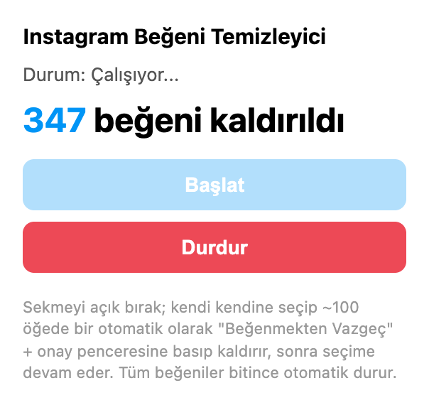
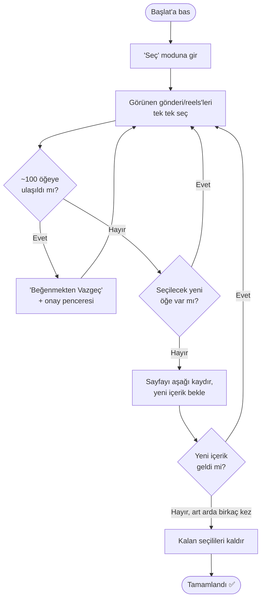
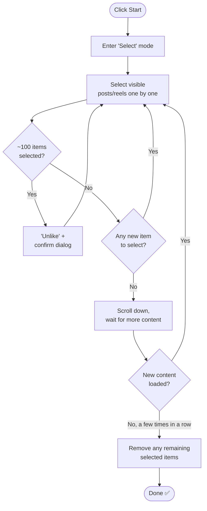

# Instagram Unlike All (Likes Cleaner)

**🇹🇷 Türkçe** | [🇬🇧 English](#-english)

A Chrome extension that automatically selects and removes **all of your likes**
(posts & reels) from Instagram's own
**"Your Activity > Interactions > Likes"** page
(`instagram.com/your_activity/interactions/likes/`).

> ⚠️ **Disclaimer:** This is an unofficial, third-party tool. It is **not**
> affiliated with, endorsed by, or connected to Instagram or Meta in any way.
> It automates clicks on Instagram's own web UI using your already-logged-in
> session — it does not use any private/undocumented API and does not touch
> your password or any credentials. That said, **automating actions on
> Instagram may violate Instagram's Terms of Service**, and could trigger a
> temporary rate-limit / "unusual activity" restriction on your account. Use
> entirely at your own risk and responsibility. The author provides no
> warranty and accepts no liability for any consequences of using this tool
> (see [LICENSE](./LICENSE)).

<p align="center">
  
</p>

<p align="center"><sub>The extension's popup while running — a live counter and Start/Stop controls.</sub></p>

---

## 🇹🇷 Türkçe

### Ne işe yarar?

Instagram'ın **"Hareketlerin > Etkileşimler > Beğeniler"** sayfasındaki
(`instagram.com/your_activity/interactions/likes/`) tüm post ve reels
beğenilerini otomatik olarak kaldırır:

- Sayfadaki gerçek **"Seç"** mekanizmasını kullanarak gönderi/reels'leri seçer
- Instagram'ın seçim üst sınırına (gözlemle ~100 öğe) ulaşınca otomatik olarak
  **"Beğenmekten Vazgeç"** + açılan onay penceresine basar
- Sayfayı aşağı kaydırıp yeni içerik yükler, bu döngüyü **hiç beğeni
  kalmayana kadar** tekrarlar
- Chrome sekmeyi/pencereyi arka plana attığında işlemin durmaması için
  (duyulmayacak kadar kısık) bir arka plan-aktif-tutma sesi çalar

Hepsi tamamen otomatik — bir kez "Başlat"a bastıktan sonra sen başka bir
işle uğraşabilirsin.

### Kurulum

1. Bu repoyu indir / klonla:
   ```bash
   git clone https://github.com/<kullanıcı-adın>/instagram-unlike-extension.git
   ```
2. Chrome'da `chrome://extensions` adresine git.
3. Sağ üstten **Geliştirici modu**'nu aç.
4. **"Paketlenmemiş öğe yükle"**'ye bas, indirdiğin `instagram-unlike-extension`
   klasörünü seç.
5. Extension listede görünecek; istersen araç çubuğuna sabitle (parça/puzzle
   ikonu).

### Kullanım

1. Instagram'da şu sayfaya git:
   `https://www.instagram.com/your_activity/interactions/likes/`
2. Extension ikonuna tıkla, popup açılsın.
3. **Başlat**'a bas. Sekmeyi açık bırakman yeterli; işlem arka planda kendi
   kendine devam eder (hatta Chrome'u tamamen arkaya atsan bile).
4. Popup'ta kaç beğeninin kaldırıldığını canlı görebilirsin.
5. İstediğin an **Durdur**'a basarak kesebilirsin.
6. Beğeni kalmayınca durum otomatik "Tamamlandı ✅" olur.

İlerlemeyi Console'dan (Cmd+Option+I / F12) da izleyebilirsin — her adım
`[IG Unliker] ...` ile loglanır.

### Nasıl çalışır?

`content.js`, Instagram'ın "seç + toplu kaldır" akışını uçtan uca taklit eder:
metin tabanlı buton tespiti (`"Seç"`, `"İptal"`, `"Beğenmekten Vazgeç"`),
her seçimin "X seçildi" sayacıyla **gerçekten doğrulanması**, seçim üst
sınırına ulaşınca otomatik kaldırma, taze kaydırma konteyneri tespiti ve
hata durumunda kademeli olarak kendi kendine tekrar deneme içerir. Detaylı
teknik açıklama ve ayarlanabilir parametreler (hız, bekleme süreleri) için
`content.js` içindeki yorum satırlarına bakabilirsin.



### Sorun giderme

- Extension'ı çalıştırmadan önce Console'u (F12 / Cmd+Option+I) açık tutman
  önerilir — ne yaptığını canlı izleyebilirsin.
- `"Seç" linki bulunamadı` / `"Beğenmekten Vazgeç" butonu bulunamadı` gibi
  uyarılar görüyorsan, Instagram arayüzü güncellenmiş olabilir; `content.js`
  içindeki ilgili metin sabitlerini sayfada gördüğün güncel metinle
  değiştirip extension'ı yenile.
- Hız ayarlamak istersen `content.js` içindeki `delay(...)` çağrılarına
  bakabilirsin — ne kadar düşürürsen Instagram'ın otomasyonu fark etme
  riski o kadar artar.

### Katkıda bulunma

Pull request'lere açığım. Hata bulursan bir issue açabilirsin (mümkünse
Console loglarıyla birlikte).

---

## 🇬🇧 English

### What does it do?

This Chrome extension automatically removes **all your likes** (posts &
reels) from Instagram's own **"Your Activity > Interactions > Likes"** page
(`instagram.com/your_activity/interactions/likes/`):

- Uses the page's native **"Select"** mechanism to select posts/reels
- When Instagram's selection cap is hit (observed ~100 items), it
  automatically clicks **"Unlike"** and confirms the dialog that follows
- Scrolls down to load more content and repeats the whole cycle until
  **no likes remain**
- Plays a near-inaudible keep-alive sound so the process keeps running even
  if you move the Chrome tab/window to the background

Fully automatic — click "Start" once and go do something else.

### Installation

1. Clone / download this repo:
   ```bash
   git clone https://github.com/<your-username>/instagram-unlike-extension.git
   ```
2. Open `chrome://extensions` in Chrome.
3. Enable **Developer mode** (top right).
4. Click **"Load unpacked"** and select the downloaded
   `instagram-unlike-extension` folder.
5. The extension will appear in your list; optionally pin it to the toolbar
   (puzzle-piece icon).

### Usage

1. Go to this Instagram page:
   `https://www.instagram.com/your_activity/interactions/likes/`
2. Click the extension icon to open the popup.
3. Click **Start**. Just keep the tab open — the process continues on its
   own in the background (even if you fully switch away from Chrome).
4. The popup shows a live count of how many likes have been removed.
5. Click **Stop** at any time to interrupt it.
6. When there's nothing left to remove, the status automatically switches
   to "Done ✅".

You can also watch progress live in the Console (Cmd+Option+I / F12) — every
step is logged with an `[IG Unliker] ...` prefix.

### How it works

`content.js` replicates Instagram's "select + bulk remove" flow end to end:
text-based detection of the relevant buttons (`"Select"`, `"Cancel"`,
`"Unlike"`), **real verification** of every selection via the "X selected"
counter, automatic bulk-removal once the selection cap is hit, a
freshly-resolved scroll container on every scroll (to avoid stale DOM
references), and a self-healing retry loop with increasing backoff on
failure. See the inline comments in `content.js` for the full technical
details and tunable parameters (speed, delays).



### Troubleshooting

- Keep the Console open (F12 / Cmd+Option+I) before starting — you'll see
  exactly what it's doing in real time.
- If you see warnings like `"Select" link not found` / `"Unlike" button not
  found`, Instagram's UI may have changed; update the matching text
  constants in `content.js` to whatever text you currently see on the page,
  then reload the extension.
- To tune speed, look at the `delay(...)` calls in `content.js` — the lower
  you go, the higher the risk Instagram flags the activity as automated.

### Contributing

PRs welcome. Feel free to open an issue if you find a bug (ideally with
Console logs attached).

---

## License

[MIT](./LICENSE)
